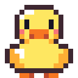
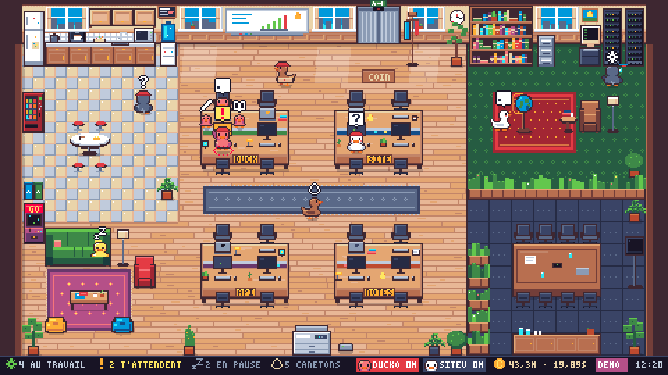
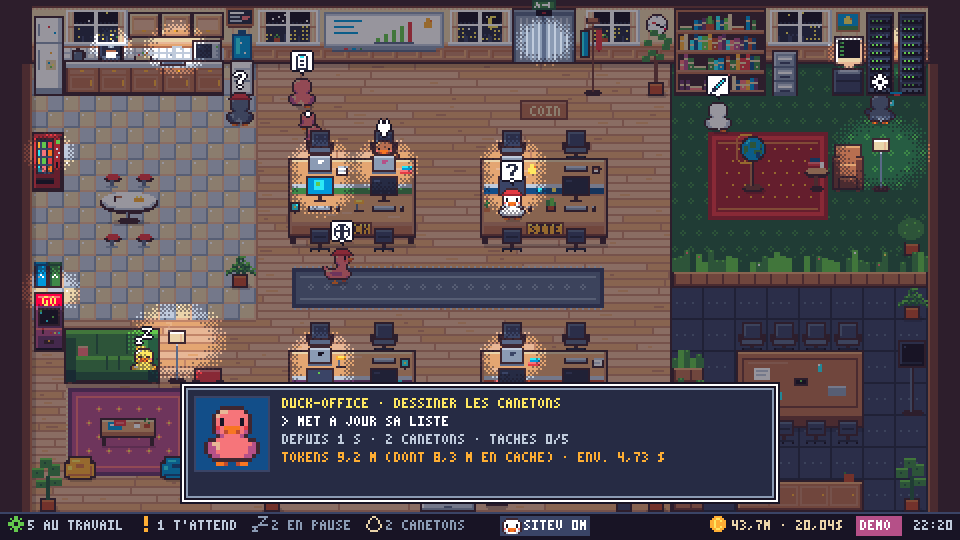
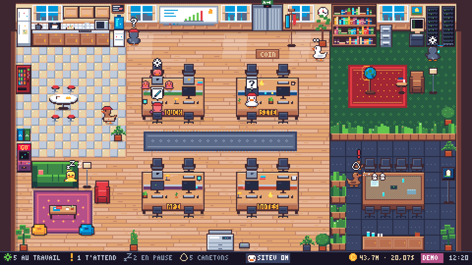
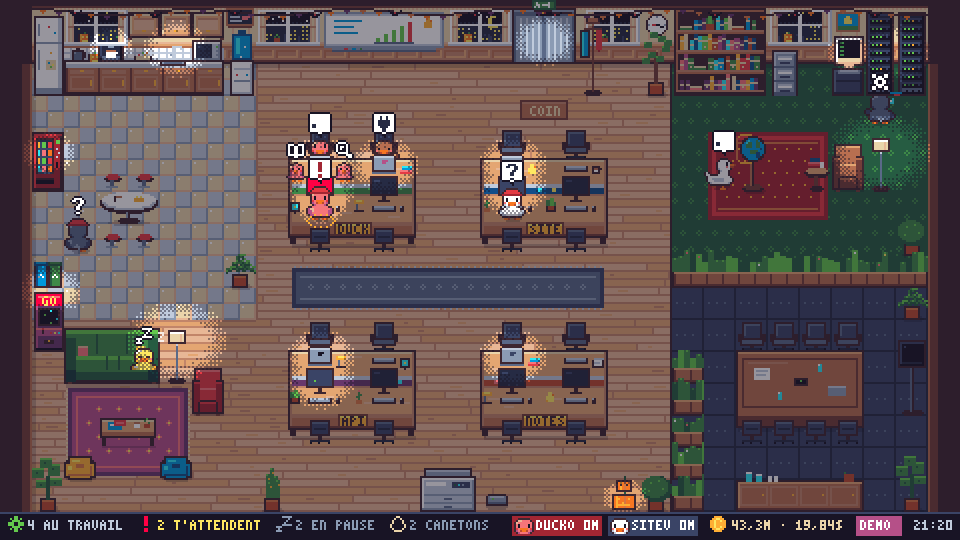
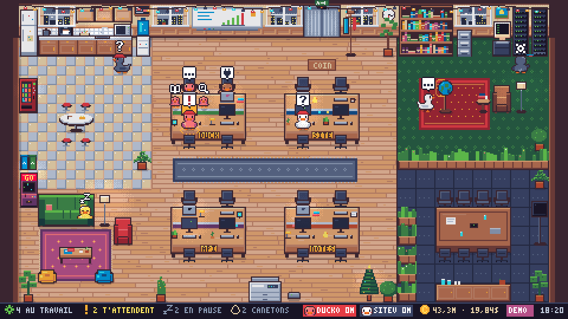
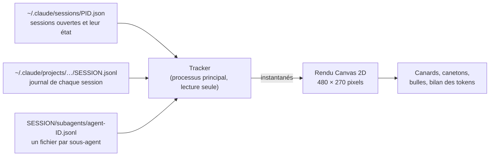

<div align="center">



# Duck Office

**Tes agents Claude Code, en canards, dans un open space en pixel art.**

<sub><i>Your Claude Code agents as pixel-art ducks in a cozy open-space office, in a small Windows app.</i></sub>

<br />


<br />



</div>

## Pourquoi ?

Quand plusieurs sessions Claude Code et leurs sous-agents tournent en même temps, on ne sait plus qui travaille, qui attend une permission et qui a fini. Duck Office le montre d'un coup d'œil, dans une petite fenêtre façon vieux jeu vidéo : **chaque session est un canard, chaque sous-agent un caneton**, et les canards qui t'attendent sont impossibles à rater.

## Ce que tu vois

| Ce que fait l'agent | Ce que fait le canard |
|---|---|
| Réfléchit | Reste assis à son bureau, bulle « … » |
| Écrit du code | Tape vite sur son portable, avec des étincelles |
| Lit ou fouille les fichiers | Lit à son bureau ; si ça dure, va à la bibliothèque ou au classeur |
| Lance une commande | Va au terminal ou aux serveurs ; si c'est long, prend un café |
| Cherche sur le web | Fait tourner le globe |
| Met à jour sa liste de tâches | Écrit au tableau blanc |
| Lance des sous-agents | Va à la table de réunion : des œufs éclosent, les canetons le suivent |
| **Attend ta permission** | **Monte sur son bureau, lève l'aile, un « ! » clignote** |
| **A fini, attend ta réponse** | **Monte sur son bureau avec un « ? »** |
| Inactif depuis 5 min | Va au coin détente, prend un café, joue à la borne d'arcade |
| Inactif depuis 20 min | Fait la sieste sur le canapé (zZ) |
| Session fermée | Fait coucou et repart par l'ascenseur |

- **La couleur du canard** indique le projet : les sessions d'un même projet partagent un îlot de bureaux.
- **Le chapeau** distingue les sessions d'un même projet.
- **Les bureaux sont face à face :** un canard te regarde par-dessus son portable, celui d'en face te tourne le dos devant son écran allumé.
- **Les fenêtres suivent l'heure réelle :** jour, coucher de soleil, nuit étoilée. Le soir tombe peu à peu et les lampes s'allument une à une.
- **Il fait un temps différent chaque heure :** soleil, nuages, pluie (un parapluie s'égoutte au portemanteau), orage ou neige en hiver.
- **Le bureau se décore selon la saison :** citrouilles et chauves-souris pour Halloween, sapin et guirlandes à Noël.

### Les petites réactions

| Ce qui arrive | Ce que fait le canard |
|---|---|
| Tu accordes une permission | Il hoche la tête, content, avant de redescendre de son bureau |
| Il coche toute sa liste de tâches | Confettis, une coche verte, le tableau blanc tout vert |
| Une commande dure plus de 20 s | Une goutte de sueur perle sur sa tempe |
| Une erreur de l'API | Trois petites étoiles tournent au-dessus de sa tête |
| Un caneton revient de mission | Sa cane le félicite |
| La cane se déplace | Ses canetons la suivent en file indienne |
| Il range sa mémoire (compaction) | Des feuilles s'envolent de la photocopieuse |

La nuit, un halo éclaire les canards qui t'attendent, pour que le « ! » et le « ? » ne se perdent jamais dans l'ombre. Le bureau s'éteint quelques minutes après le départ du dernier canard, et se rallume lampe par lampe avec le premier.

### La vie du bureau

De temps en temps, toutes les 3 à 8 minutes, il se passe quelque chose. Il n'arrive qu'un seul événement à la fois, et jamais pendant qu'un canard attend ta permission.

- un pigeon se pose sur le rebord d'une fenêtre ; un avion avec une banderole ou une montgolfière passe ; une étoile filante la nuit ;
- une coupure de courant la nuit (« BZZT ») ;
- la machine à café tombe en panne, ou la photocopieuse bourre : un canard en pause vient réparer ;
- le robot aspirateur fait sa tournée ;
- le chat du bureau sort de l'ascenseur et fait la sieste sur le tapis ;
- deux canards en pause font une partie d'arcade ;
- à midi ou le soir, un livreur apporte une pizza ;
- un anniversaire, avec un gâteau sur la table de réunion ;
- un canard arrose une plante, qui fleurit pour le reste de la journée.

**Qui t'attend ?** Un compteur en bas de l'écran, le nombre dans le titre de la fenêtre, le bouton de la barre des tâches qui clignote et un « ! » rouge sur l'icône de la zone de notification.

<table>
  <tr>
    <td width="50%"></td>
    <td width="50%"></td>
  </tr>
  <tr>
    <td align="center"><sub>La nuit, et la fiche d'un canard façon vieux RPG</sub></td>
    <td align="center"><sub>Une cane briefe ses canetons à la table de réunion, la pizza arrive</sub></td>
  </tr>
  <tr>
    <td width="50%"></td>
    <td width="50%"></td>
  </tr>
  <tr>
    <td align="center"><sub>Halloween : citrouilles, chauves-souris et lampes allumées</sub></td>
    <td align="center"><sub>Noël : sapin, guirlandes et neige derrière les vitres</sub></td>
  </tr>
</table>

## Installation

Il faut **Windows 10 ou 11** (testé sur Windows 11), **[Node.js](https://nodejs.org) 22 ou plus récent**, et bien sûr **[Claude Code](https://claude.com/claude-code)**.

```powershell
git clone https://github.com/giregls/duck-office.git
cd duck-office
npm install
npm start        # le premier lancement télécharge Electron (~160 Mo)
```

Pour avoir un raccourci **Duck Office** sur le Bureau et dans le menu Démarrer :

```powershell
powershell -NoProfile -ExecutionPolicy Bypass -File scripts\install-shortcut.ps1
```

Pas d'agent en cours sous la main ? `npm run demo` remplit l'open space de faux canards.

## Utilisation

| Action | Effet |
|---|---|
| Clic sur un canard | Sa fiche : projet, action en cours, depuis quand, canetons, tokens |
| Clic sur une pastille en bas | La fiche du canard qui t'attend |
| `C`, ou clic sur la pièce en bas | Tokens et coût du jour, par projet et par modèle |
| `M` | Mode mini : petite fenêtre sans bordure, toujours au premier plan |
| `D` | Mode démo |
| `H` | Aide |
| `Échap` | Fermer la fiche ou le panneau ouvert |

Un clic droit sur l'icône de la zone de notification propose aussi la fenêtre normale ou mini, « toujours au premier plan », le mode démo et « Quitter ».

## Tokens et coût

- **En bas à droite :** les tokens consommés aujourd'hui, par toutes les sessions ouvertes ou fermées, et leur coût. Le bilan détaille par projet et par modèle.
- **Dans la fiche d'un canard :** les tokens de sa session, canetons compris, dont la part relue depuis le cache.

Le coût est calculé **au tarif de l'API Anthropic**, modèle par modèle, cache compris, même avec un abonnement : c'est un ordre de grandeur, pas une facture. Les prix d'Opus, Sonnet et Haiku 5.5 ont été vérifiés contre les totaux que Claude Code écrit lui-même à la fin d'une session. Dès qu'une session se termine, l'app utilise ce total exact.

> [!NOTE]
> Pendant qu'une session tourne, certains appels faits en coulisses (vérifications du mode auto, génération des titres…) n'apparaissent pas dans ses journaux. L'estimation est donc un peu basse : de 5 à 25 % sur les sessions testées.

## Comment ça marche



1. **La liste des sessions ouvertes** (`~/.claude/sessions/`) dit, pour chacune, si elle travaille, attend une permission ou une réponse, ou ne fait rien.
2. **Le journal de chaque session** (`~/.claude/projects/`) est lu au fil de l'eau : outil en cours, titre, liste de tâches, tokens consommés.
3. **Chaque sous-agent** a son propre journal, rattaché à sa session : c'est un caneton.

Ces formats ne sont pas documentés par Anthropic : le détail de ce qui est lu, et pourquoi, est dans [docs/claude-code-format.md](docs/claude-code-format.md). La variable `CLAUDE_CONFIG_DIR` est respectée.

## Vie privée et sécurité

- **Lecture seule :** l'app n'écrit jamais dans `~/.claude` et ne modifie pas ta configuration Claude Code (aucun hook à installer).
- **Rien ne sort de ta machine :** pas d'envoi sur Internet, aucun port réseau ouvert.
- **Pas de secrets :** elle n'ouvre jamais les fichiers sensibles (`*.key`, `.credentials.json`).
- **Pas de contenu :** elle n'affiche ni tes messages ni tes commandes, seulement le titre d'une session, un nom de fichier ou la courte description d'une commande.

## Limites connues

- Les formats lus peuvent changer avec une mise à jour de Claude Code ; le tracker ignore ce qu'il ne comprend pas, sans planter.
- Pendant une longue réponse, le canard « réfléchit » jusqu'au bout : Claude Code n'écrit l'outil choisi qu'à la fin de la réponse.
- Quand un sous-agent demande une permission, c'est sa cane qui lève l'aile.
- Les sessions du terminal sont les mieux suivies. Celles de Claude Desktop et de VS Code sont repérées par leurs journaux, mais ont été moins testées.

## Développement

```text
src/
  main/
    main.js          fenêtre (normale ou mini), icône de notification, mode capture
    icons.js         icônes PNG/ICO dessinées à partir du sprite du canard
    tracker/         lecture de ~/.claude : sessions, journaux, sous-agents, tokens
  renderer/          scripts classiques partageant globalThis.DO, chargés dans l'ordre :
    palette.js  font.js  sprites.js  office.js  world.js  events.js  ui.js  sim.js  app.js
  shared/tools.js    catégories d'outils et libellés sans données privées
test/                tests du tracker et du comportement des canards (horloge simulée)
```

```bash
npm test                 # tests (Node 22+)
npm run debug:tracker    # ce que voit le tracker, en texte
```

Le mode capture enregistre une image sans ouvrir de fenêtre, pratique pour vérifier un rendu :

```bash
node_modules/electron/dist/electron.exe . --capture=shot.png --demo --no-tracker --hour=22 --seed=7
```

Options : `--scale=3`, `--crop=x,y,w,h`, `--select=0` (ouvre une fiche), `--bilan`, `--scenario=hatch|arrive|busy`, `--frames=90 --frame-interval=110` (une série d'images, comme pour l'animation ci-dessus), `--capture-delay=4000`, `--weather=clear|cloudy|rain|storm|snow`, `--date=2026-12-24` (décor de saison), `--event=pigeon|sky|blackout|coffee|printer|robot|arcade|cat|pizza|birthday|watering --event-at=500` (force un événement). Lance les captures une par une : en parallèle, elles se disputent le même dossier de cache.

Tout le pixel art est **dessiné par le code**, sans aucun fichier image : les sprites sont des grilles de caractères dans `sprites.js`, les meubles des rectangles dans `office.js`. La palette est [ENDESGA 32](https://lospec.com/palette-list/endesga-32), et l'image interne fait 480 × 270 pixels, agrandie d'un facteur entier pour rester nette.

## Crédits

- Palette [ENDESGA 32](https://lospec.com/palette-list/endesga-32) par Endesga.
- Idée inspirée de [Pixel Agents](https://github.com/pixel-agents-hq/pixel-agents) (MIT) ; aucun code ni image n'en est repris.
- Conçu et codé avec [Claude Code](https://claude.com/claude-code).

## Licence

[MIT](LICENSE)
